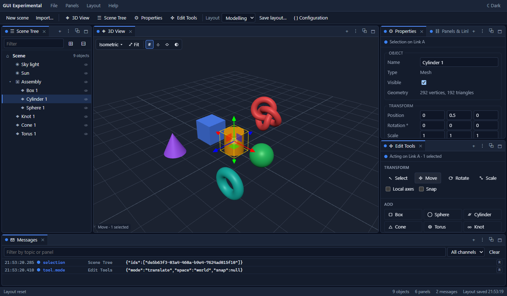

# GuiExperimental

***Playing with technologies***

A workbench of panels in one browser page, built with Angular 22 and three.js. Panels are rectangles that can be:

- **Arranged** by dragging their tabs, or by writing the layout as JSON.
- **Tabbed** together, split side by side, or floated in windows over the page.
- **Linked**, so that they work together.
- **Saved** as layouts and restored.

The sample panels edit a 3D scene: 3D views, a scene tree, properties, editing tools, ray tracing with [MeerCADRaytracer](https://github.com/VJigouline/MeerCADRaytracer), IFC and STEP import with [MeerCADIFCImport](https://github.com/VJigouline/MeerCADIFCImport) and [MeerCADStepImport](https://github.com/VJigouline/MeerCADStepImport), a message log, and a list of panels and their links.

**Try it:** [vjigouline.github.io/gui-experimental](https://vjigouline.github.io/gui-experimental/)



## Running it

```bash
npm install
npm start          # http://localhost:4200/
npm test           # unit tests, with Vitest
npm run build      # production build in dist/
npm run deploy     # build and publish to GitHub Pages
```

It needs Node.js 22.22, 24.15, or 26 and later, as Angular 22 does. The page needs a browser with WebGL.

`npm run deploy` builds the app for the `/gui-experimental/` path and pushes it to the `gh-pages` branch, which GitHub Pages serves. Changes appear on the site a minute or so later.

## Arranging panels

- **Drag a tab** onto another panel:
  - Over the middle, it becomes a tab there.
  - Over a side, it splits that panel.
  - Over the tab strip, it goes between the tabs.
- **Drag a tab to the outer edge** of the workspace to put it along that whole edge.
- **Float a panel** in a window:
  - Hold **Ctrl** as you drop it, or use ⧉ on its stack or in its tab menu.
  - Drag a window by its title, and resize it from its edges.
  - Double-click the title, or use ⇲, to dock it again.
- **Resize** with the gutters between panels. Double-click a gutter to share the space equally; with a gutter focused, the arrow keys move it.
- **Maximize** a stack by double-clicking a tab, or with 🗖.
- **Close** a panel with its ✕, or by middle-clicking its tab.
- **Add panels** from the Panels menu, the toolbar, or a stack's ＋ button. Menu and toolbar items can also be dragged into place, like tabs.
- **Rename, relink, float or close** from a tab's menu: right-click it, or use ⋮.

## Linking panels

Every panel is on a *link channel*: Link A, B, C, D, or Unlinked. The coloured dot on its tab shows which. Panels on the same link share:

- **The selection:** select in a 3D view or the scene tree, and the properties, tools and other views on that link follow.
- **The transform tool:** move, rotate or scale, set in the tools or with W, E and R in a 3D view.
- **View commands:** framing objects, and views from the top, front and so on.

Panels on different links work independently, though they all show the same scene. The **Two links** preset has two sets of panels, each with its own selection. An unlinked panel talks only to itself.

Set a panel's link from its tab menu, or set them all in **Panels & Links**. **Messages** lists what the panels send each other.

## Saving layouts

- **Automatically:** the layout is saved in the browser after each change and restored on the next visit. This covers each panel's own settings too, such as a 3D view's camera, grid and background.
- **By name:** use **Layout › Save layout as…**, and load or manage named layouts from the Layout menu.
- **As JSON:** **Layout › Configuration…** shows the layout as JSON. Edit it and apply it, or download it as a file and open it again later; **File** has the same.
- **Presets:** **Layout › Presets** has ready-made layouts: Modelling, Two views, Two links and Viewer.

The JSON format is described in [Documentation/Layout-Format.md](Documentation/Layout-Format.md). It can be written by hand, for example:

```json
{
  "root": {
    "type": "split", "direction": "row", "sizes": [1, 3],
    "children": [
      { "type": "stack", "panels": [{ "type": "scene-tree" }] },
      { "type": "stack", "panels": [{ "type": "viewport", "title": "Main" }, { "type": "properties" }] }
    ]
  }
}
```

## The panels

| Panel | What it does |
|---|---|
| 3D View | The scene, with its own camera. Drag to orbit, right-drag to pan, scroll to zoom. Click to select, Shift+click to add to the selection, double-click to frame. **Sizing shapes:** with a box, sphere, cylinder, cone, torus or plane selected, drag its face, edge or corner to change its size; the cursor shows what will be held. A box face changes one size, an edge two and a corner three. A cylinder's or cone's side changes the diameter, a cap or the apex the height, and a rim both. A torus's outside or inside changes its outer or inner diameter, and its front or back the thickness. The opposite side stays put; hold Ctrl to keep the centre instead. Engineering dimension lines show the sizes as they change, Snap in Edit Tools rounds them, and Esc puts the shape back. Keys: Q select, W move, E rotate, R scale, F fit, B zoom box, Delete remove, Esc deselect, G walk, L face loops, Z ray trace. Walk mode (G, or 🚶 Walk): WASD or the arrows move over the ground, Q/E go down and up, drag to look, middle-drag walks left, right, up and down, the wheel walks forward and back, Shift goes fast (3× with the keys, 5× with the mouse), Ctrl+wheel sets the speed, Esc leaves. ⚙ next to Walk opens Walk settings, for the view's normal speed in m/s and the two fast multipliers. Zoom box (⊕ Zoom, or B): drag a rectangle and the view zooms to it, keeping its direction; a click zooms in twice about that point. Its toolbar sets the view direction, grid, axes, wireframe, face loops and background. Face loops (⬚, or L) are the edges of solid faces and surfaces in STEP models, drawn over the faces; the button is off when the scene has none. |
| Scene Tree | The scene's objects as a tree. Click to select; Ctrl+click and Shift+click select more. Double-click to frame, 👁 to hide. Drag a row onto another to move it inside. |
| Properties | The selected object's name, visibility, transform, material or light, for editing; for a box, sphere, cylinder, cone, torus or plane, also its dimensions. For IFC elements, also their entity type, GlobalId, materials and property sets; for STEP parts, their product and shape item. |
| Edit Tools | The transform tool, with local axes and snapping. Adds shapes, groups, lights and models (glTF, GLB, STL, OBJ, IFC, STEP). Duplicates, deletes, groups and ungroups the selection. |
| Ray Tracing | Photorealistic images of a 3D view with MeerCADRaytracer, as on SceneEditor's Photorealistic tab. See [Ray tracing](#ray-tracing). |
| Messages | The messages panels send each other, with their channel, sender and content. |
| Panels & Links | Every open panel, with its title, link and place, for editing. |

## Importing models

glTF, GLB, STL, OBJ, IFC and STEP files can be imported from **File › Import model…**, the toolbar's **Import…**, or **Edit Tools**. They can also be dropped onto the page. As in SceneEditor:

- **IFC files** are read with [MeerCADIFCImport](https://github.com/VJigouline/MeerCADIFCImport): IFC2X3 and the IFC4 line, in metres with Y up. The **Import IFC** dialog sets its options first: cutting openings out of elements, circle segments, the smoothing angle, room volumes, opening volumes, and property sets. The choices are kept in the browser. Untick *Ask before each IFC import* to skip the dialog, and change the settings later in **File › IFC import settings…**.
- **STEP files** (`.stp`, `.step`, `.p21`, and gzip-compressed `.stpz`) are read with [MeerCADStepImport](https://github.com/VJigouline/MeerCADStepImport): AP203, AP214, AP242 and others, with their assembly structure, colours and units, in metres with Y up. The **Import STEP** dialog sets the tessellation first. Quality is the chord tolerance as a share of each solid's size. The angle and the per-face triangle limit can also be set, as can whether to include hidden items or prefer AP242 tessellated shapes. It is remembered and can be skipped like the IFC dialog; **File › STEP import settings…** changes it later. An IFC file named `.stp` is refused with a Failure dialog. Files of 2 MB or more are tessellated in web workers (`src/app/scene/step.worker.ts`), up to six at once. A 95 MB assembly then imports in about 6 s rather than 15, and the page keeps drawing meanwhile.
- **While a file imports,** a dialog says so, since the readers run in the page. Large IFC models take a few seconds.
- **A file that can't be read** shows a **Failure** dialog with the reason, and the scene is unchanged. Warnings go to the browser console.
- **Afterwards,** the model is named after its file, and selected and framed on a link channel. That's Link A from the menu or toolbar, the Edit Tools panel's link from there, or the link of the panel the files were dropped on.

Selecting an IFC element shows its IFC data in Properties, with each property set as a section that opens. Selecting a STEP part or assembly shows its product, ID and placement, and for its meshes the shape item they came from.

## Ray tracing

[MeerCADRaytracer](https://github.com/VJigouline/MeerCADRaytracer) traces the scene in web workers, as in SceneEditor.

- **Over a 3D view:** press **Z** in a 3D view, or use its ☀ Ray trace button, to show the ray traced image over it. Press Z again to go back. The view still takes the mouse, so orbiting, selecting and the gizmo keep working, and every change starts the image again.
- **In a separate window:** the Ray Tracing panel's ⧉ Window opens a browser window showing the image, which follows the 3D view's camera while the view keeps drawing with WebGL. Closing that window turns ray tracing off.
- **The Ray Tracing panel** chooses which 3D view to trace, and shows progress. It restarts, stops and saves the image as PNG, and has SceneEditor's settings: samples, bounces, resolution, preview, worker threads, shadows, global illumination, tone mapping, exposure, colour space and background. The settings are kept in the browser.
- **Adding the panel:** it is a tab in the Modelling preset. Added from the Panels menu or toolbar, it opens in a floating window, like a dialog box.

One renderer is shared, so one 3D view is traced at a time.

## How it is built

```
src/app/
  core/
    layout/        the layout model, its operations, the JSON reader, and LayoutService
    bus/           PanelBus: messages between panels on link channels
    panels/        panel types, PanelContext, and PanelHost, which keeps panels alive as they move
    workbench.providers.ts
  dock/            the docking UI: stacks, splits, floating windows, dragging
  ui/              menus, dialogs, theme
  panels/          the sample panels, their registry and the layout presets
  scene/           SceneDocument, the shared three.js scene, and model import, including IFC and STEP
  raytrace/        RaytraceService and its web worker, running MeerCADRaytracer
  workbench/       the page: menu bar, toolbar, workspace and status bar
```

- **Layouts are plain JSON** held in a signal. Every change goes through pure functions in `layout.ops.ts`, which return a new layout.
- **Panels keep their state as they move:** each is made once and its element is moved between containers, so a 3D view keeps its WebGL context. Hidden tabs wait off-screen, still alive.
- **Lazy loading:** the workbench, three.js and the panels load after the page shell.
- **Adding a kind of panel** takes a component and an entry in `panels/panel-types.ts`. See [Documentation/Writing-Panels.md](Documentation/Writing-Panels.md).

## Versions

- **Angular** 22.2, standalone, zoneless, with signals.
- **TypeScript** 6.0. This is the newest version Angular 22 supports; TypeScript 7 isn't supported yet.
- **three.js** 0.187.
- **MeerCADRaytracer**, **MeerCADIFCImport** and **MeerCADStepImport**, pinned to commits, as in SceneEditor.
- **Vitest** 5, for the unit tests.
